# Figgie

This repository is a simulation of [Jane Street's Figgie](https://www.janestreet.com/figgie/), the card game they use to teach trading. Four players are dealt a hidden deck, trade the four suits through a matching engine, and get paid at the end for holding the one suit that turns out to be the goal. The code here runs that game with seven hand-written strategies, then puts them through a tournament.

The short version of the result: a player that values cards from the rules of the payout, and then only trades when the price on the book is better than that value, beats the same valuation playing at random. In the league that player, `fundamentalist2`, won 99 of its 144 duels. The plain `fundamentalist`, which shares the valuation and picks suits and prices at random, won 83.

## How a round of Figgie works

Four players. Four suits: hearts and diamonds are red, clubs and spades are black. The deck has 40 cards, so each player is dealt 10. The suit counts are always 12, 8, 10, and 10, assigned at random to the four suits. Nobody sees the assignment. You see only your own hand.

One suit is the **goal suit**. It is the other suit of the same color as the suit that was dealt 12 cards. If hearts has 12, diamonds is the goal. If clubs has 12, spades is the goal. The goal suit itself then holds either the 8 or one of the 10s, depending on how the counts landed. At the end of the round only goal-suit cards pay. The other three suits pay nothing.

Before trading, each player pays an ante of 50 into the **pot**. The pot starts at 200. Trading then runs for a fixed time. A player submits an **order**: a **bid** to buy one card of one suit, or an **offer** to sell one card of one suit, at a stated price. Each suit shows at most one bid and one offer at a time. A bid that meets the offer, or an offer that meets the bid, is a **trade**: one card moves, chips move the other way, and every resting quote in every suit is cancelled. Players then quote again.

When time expires the round settles.

- Every goal-suit card pays 10 chips to whoever holds it. That money comes out of the pot.
- Whatever is left in the pot is split by the players who hold the most goal-suit cards. A tie splits it evenly.

If the goal suit has 8 cards, the card bonuses take 80 out of the pot and 120 remains for the leader. If the goal suit has 10 cards, the bonuses take 100 and 100 remains. A goal card is therefore worth the 10 chip bonus plus whatever it does to your chance of holding the most of them. A card of any other suit is worth nothing at settlement. Its only use during the round is as something you can sell.

A match in this simulator is four rounds. Everyone starts with 350 chips. A player who cannot pay the next ante of 50 is finished, and the match stops. Payoff in the tables below is final chips minus 350.

## How this repository runs the game

`game_engine.py` deals the cards, collects the ante, and runs the four rounds. `order_book.py` is the matching engine: one bid and one offer per suit, a trade clears the book, and each order comes back as an order handle whose status is filled, resting, cancelled, or rejected. The strategies in `player.py` also read the quotes on the book and the list of trades, which is how the fundamentalists keep a count of cards they have seen.

A single match of four greedy players, two minutes of trading per round, is:

```bash
python3 -m venv .venv
.venv/bin/pip install numpy matplotlib ipykernel
.venv/bin/python game_engine.py
```

That writes `figgie.log`. `analyser.ipynb` reads the log and draws the greedy-bot charts below. The notebook kernel is the `.venv` in this folder. If Cursor does not list it:

```bash
.venv/bin/python -m ipykernel install --user --name figgie --display-name "Python (Figgie)"
```

## The seven players

All seven sit in the same market. They differ in what they treat as information.

| Player | What it believes | What it does with a price |
|---|---|---|
| `greedy` | The goal is the color partner of its biggest pile | Bids that suit up from 1, offers the others down from 10 |
| `random` | Nothing | Buys or sells a random suit at a random price |
| `chartist` | A suit's next price is its recent trend, extended | Quotes that extrapolated price |
| `bottom_feeder` | A suit is worth the average of other players' quotes | Quotes that average |
| `fundamentalist` | Each suit has an expected payout from the 12 possible decks | Draws a price around that value, on a random suit |
| `fundamentalist2` | The same payout | Trades only when the quote on the book beats that value, and takes the largest such gap |
| `fundamentalist3` | The same payout, read as a probability the suit is the goal | Buys the most likely goal suits and sells the least likely |

### Greedy

This is the bot the notebook studies, and the one the later players are a response to.

From its 10 cards it scores each suit as "how many of the color partner do I hold, minus how many of this suit do I hold", and it buys the suit with the best score. In the usual hand that is the color partner of the biggest pile. Bids in that suit start at 1. Offers in the other suits start at 10. A quote that is rejected, or that sits for three ticks (0.3 seconds at the normal clock), steps one chip. The bot stops stepping when a bid would reach 9 or an offer would reach 1.

The rule is a reasonable first guess. A big pile is evidence that you found the 12, and the goal is the other suit of that color. It is also how the bot ends up holding the goal and selling it. Five cards is only about an even chance that the suit is the 12. When those five are the goal instead, the bot offers them from 10 downward, and anyone who guessed the other way takes them. The notebook's case study is a hand of five clubs where clubs are the goal and the clubs are gone before the round is a second old.

These pictures are the four-greedy match in `figgie.log`, drawn by `analyser.ipynb`.

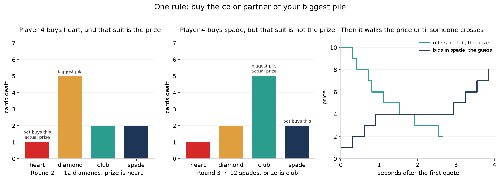

Round 2 is the clean case: five diamonds, so the bot buys hearts, and hearts is the prize. Round 3 is the failure: five clubs, clubs is the prize, and the bot buys spades instead. The right-hand panel is that player's own ladder. Offers in clubs, the prize, walk down from 10. Bids in spades, the guess, walk up from 1.

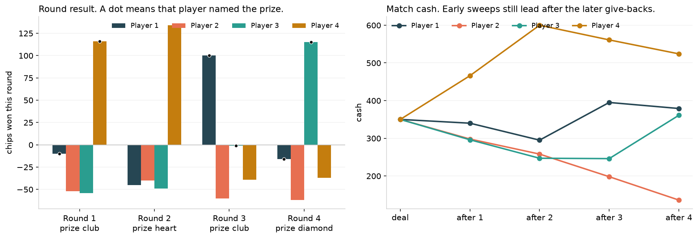

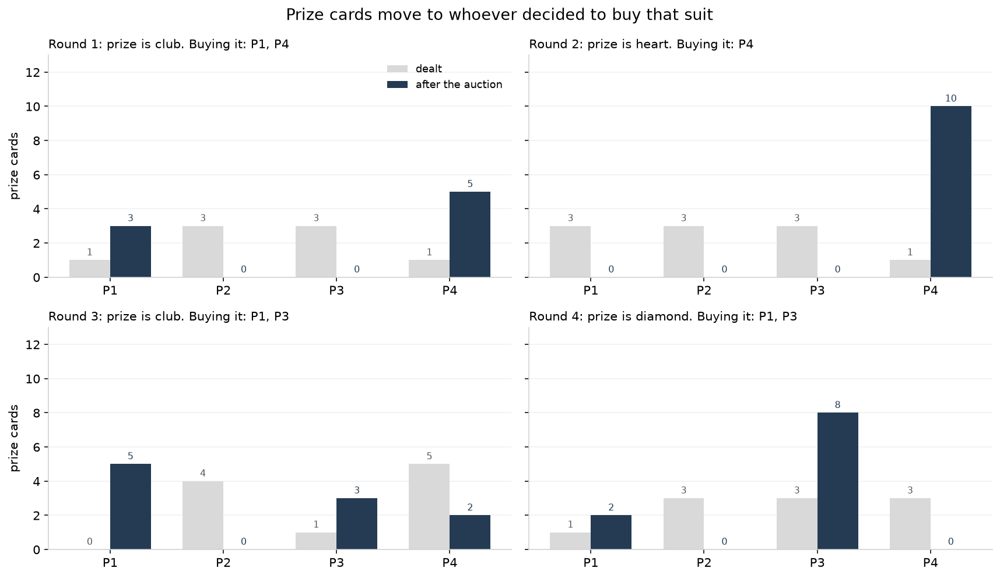

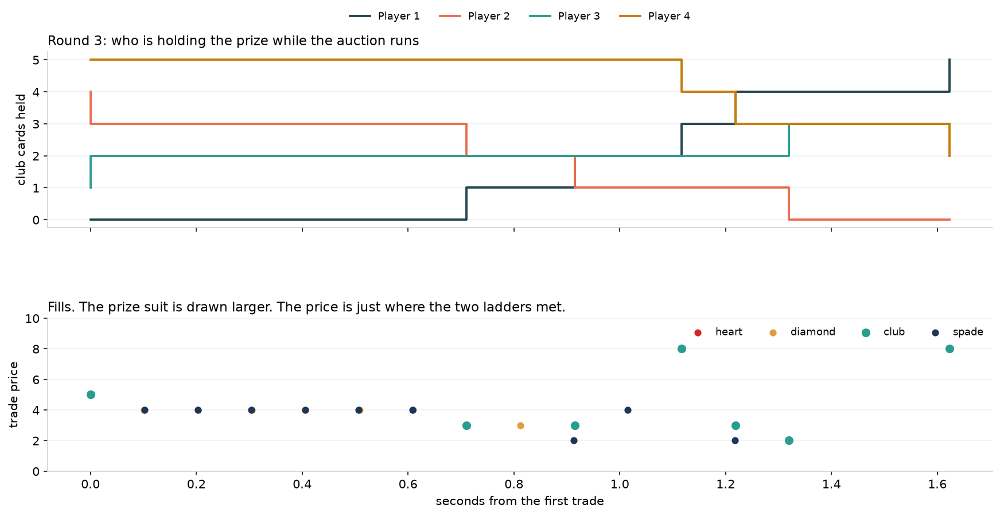

Player 4 was dealt five clubs and sold them. Within about a second and a half the clubs have moved to the players who were bidding clubs. The fills underneath sit where a bid walking up meets an offer walking down. That price is a meeting point, not a valuation.

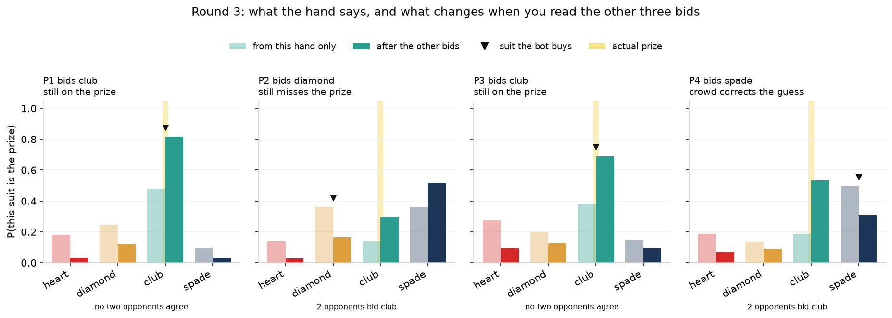

On this log the opening rule names the prize in 7 of 16 hands. Folding in the other three bids names it in 10 of 16. In round 3 the crowd moves player 4 off spades and onto clubs, which is the prize. Player 2 still peaks on spades after the same bids, so the hand and the crowd together can still miss.


Two further habits of this bot matter later.

- A tie in the hand is broken by suit order (hearts, diamonds, clubs, spades). The bot then sells the other suits in the tie, and one of those can be the goal.
- Everyone steps one chip on the same clock. A trade at 4, 5, or 6 means the ladders met. The price path is the meeting point of two clocks. The information in the trade is which suit a player will not stop bidding.

The notebook's conclusion is the design brief for the fundamentalist: pay for the showdown, because every goal card pays 10 and the remaining pot goes to whoever holds the most. Stepping a bid from 1 toward 9 does not change those numbers. It only makes sense while that suit is still a serious candidate for the goal.

### Random

`random` chooses buy or sell with equal probability, picks a suit uniformly, and draws a price between 1 and 50. It is the baseline that has no opinion about the deck. If its chips fall below 1 it skips the buy and keeps trying to sell.

### Chartist

`chartist` ignores the cards. Once a suit has seven trades, it estimates a future price from the average log return of the recent ones. The average over the last five trades telescopes to a ratio of two prices, and the quote is the latest trade pushed forward by that return. Buy and sell are still chosen at random. The quote is the extrapolated price, rounded.

### Bottom feeder

`bottom_feeder` also ignores the cards. Another player becomes prey in a suit after posting at least four bids and four offers there. The prey's value is the mid between its recent average bid and its recent average offer. The bottom feeder averages those mids and quotes the result, again on a randomly chosen side. It is trying to trade at other players' own prices.

## The fundamentalist, and the two ways of using it

The payout depends on which of 12 decks was dealt. There are 12 because the counts 8, 12, 10, 10 can be assigned to the four suits in 12 distinct ways, and each assignment fixes the goal suit as the color partner of the 12. `player.py` builds that list once. For each deck it stores the goal suit, the number of goal cards, the majority size `x` (half the goal cards, plus one: 5 when the goal has 8, 6 when it has 10), and the chips `p` left in the pot after the 10-per-card bonuses.

### What a card is worth

A card of a suit that is not the goal is worth 0 in that deck. A goal card is worth 10, plus a share of the remaining pot `p` if it moves you toward a majority. Those pot shares grow geometrically with ratio `r = 1.5` as you get closer to `x`, and they are scaled so the `x` steps that build a majority add up to the whole of `p`. Once you already hold `x` goal cards, a further card is worth only the 10 chip bonus, because you already have more than half of them.

The value the player actually uses is the average of that number over the 12 decks, weighted by how likely each deck still is. The weights are the number of ways to draw the cards the player has seen from that deck. The seen cards start as the player's own hand. Every later trade updates the count: the seller loses one, the buyer gains one. Suits that have not traded stay hidden, so the posterior moves only when cards appear.

Buying and selling use different points on that curve. The buy value is the expected value of one more card, given how many you hold now. The sell value is the expected value of the card you would give up, which is the value at one less than your current count. Because the curve is steeper near a majority, the card you are about to buy can be worth more than the card you would sell.

That valuation is shared by all three fundamentalists. They diverge in how they turn it into an order.

### `fundamentalist`: value the card, then quote at random

Each tick the original fundamentalist picks a suit at random and a side at random.

- On a buy, it draws a price uniformly between 0 and the buy value, and if an offer is showing it will not bid through it.
- On a sell, it draws a price uniformly between the sell value and twice that value, and if a bid is showing it will not offer through it.

So the price is in the right neighborhood of the fundamental value, on a suit chosen with no regard for which suit is the best trade. Many of those orders rest and never trade. Some of them cross the spread for a small edge, or for no particular reason other than the random draw. The player understands the showdown and then spends its clock the way the greedy bot spends its clock: by always quoting.

### `fundamentalist2`: the same value, and a greedy choice of when to trade

`fundamentalist2` keeps the posterior, the geometric pot value, and the separate buy and sell values. The change is one rule on top.

Each tick it looks at every suit and both sides:

- Buy edge = buy value minus the offer on the book.
- Sell edge = the bid on the book minus the sell value.

It throws away every edge that is negative or zero. If nothing remains, it waits. If several remain, it submits the single action with the largest edge, at the price already on the book. It takes a quote that is mispriced relative to the payout. It does not walk a ladder, and it does not pick a suit at random.

That is the greedy piece. Greedy, in this game, means "do the thing with the biggest gain and skip the rest." The original greedy bot applies that idea to a guessed suit and a one-chip clock. `fundamentalist2` applies it to a list of fundamental edges. The valuation does the work of deciding what a card is worth. The greedy step decides that a tick with no positive edge is a tick to do nothing, and that a tick with four possible trades should take the best one.

This is why it beats `fundamentalist` without a better model of the deck. The plain fundamentalist leaks chips by quoting random suits at random prices inside a wide band around value. `fundamentalist2` trades only when someone else is showing a price on the wrong side of the same value, which the ladder-walking greedy bots do constantly. Against three copies of the plain fundamentalist its average payoff lead was +121 chips. Head to head across every lineup that contained both, the lead was +118 chips, and `fundamentalist2` finished ahead in 64% of those 36 games.

### `fundamentalist3`: trade the most and least likely goal

`fundamentalist3` uses the same posterior, then collapses it to the probability that each suit is the goal. It buys every suit tied for the highest probability and sells every suit tied for the lowest, provided it holds one to sell. The buy price is drawn between 1 and the buy value minus 1. The sell price is drawn between the sell value and twice the sell value.

It is more directional than the original fundamentalist, because it concentrates on the suits the posterior actually favors. It still posts those orders whether or not the price on the book is attractive. In the league that was not enough to pass the original fundamentalist: 73 points to 83, and a head-to-head deficit of 31 chips.

## The tournament

Seven strategies is too many for one table, and a single four-player game is mostly the deal. The tournament in `tournament.py` does two things. Three small tables reduce the field from 7 to 5. A league then compares those five properly.

The entry order is a shuffle seeded by the first qualifier seed, so no strategy owns a favorable seat. For the published run the order was:

`random`, `greedy`, `chartist`, `fundamentalist2`, `fundamentalist3`, `fundamentalist`, `bottom_feeder`.

Qualifier tables use seeds 11, 23, and 37. Each round of trading lasts 10 seconds, and each strategy acts every 0.01 seconds. Within a table, rank is mean payoff. Ties break by win rate, then by name.

```text
Table 1: random, greedy, chartist, fundamentalist2
         top 2 qualify, bottom 2 go to table 2
Table 2: table 1's bottom 2, plus fundamentalist3 and fundamentalist
         top 1 qualifies, bottom 3 go to table 3
Table 3: table 2's bottom 3, plus bottom_feeder
         top 2 qualify, bottom 2 are eliminated
```

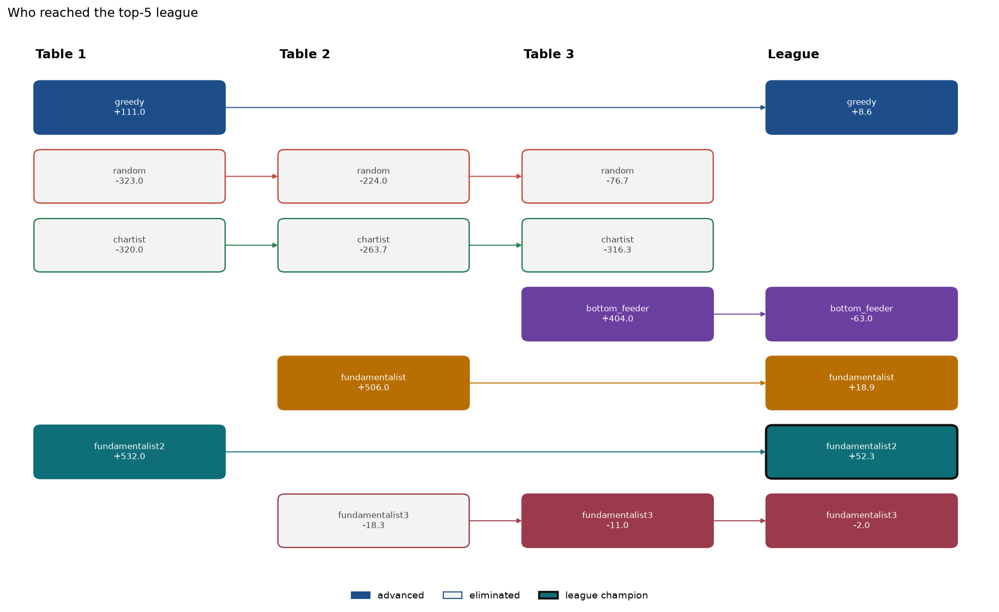

Mean payoff at each table, in chips relative to the 350 everyone started with:

| Table | Advanced | Mean payoff | Eliminated or through | Mean payoff |
|---|---|---:|---|---:|
| 1 | fundamentalist2 | +532 | chartist | −320 |
| 1 | greedy | +111 | random | −323 |
| 2 | fundamentalist | +506 | fundamentalist3 | −18 |
| 2 |  |  | random | −224 |
| 2 |  |  | chartist | −264 |
| 3 | bottom_feeder | +404 | random | −77 |
| 3 | fundamentalist3 | −11 | chartist | −316 |

`fundamentalist2` and `fundamentalist` each won every qualifier game they played. `bottom_feeder` won every game at table 3, which is what kept it in the league. `random` and `chartist` never won a game and left at table 3. Their overall mean payoffs were −208 and −300, on 9 games each.

The qualifier is a noisy filter. `fundamentalist3` came through table 3 with a negative mean payoff because second place still qualifies. The league is where the comparison is fair.

### The league

The five qualifiers play every way of sitting down together.

- 5 four-player tables, one for each strategy left out.
- For each of the 10 pairs: three copies against one, two against two, and one against three.

That is 35 lineups. Each lineup is played on six seeds, 11, 23, 37, 51, 73, and 89. That is 210 games. Every qualifier appears in 96 of them.

Scoring inside a game is a set of duels. For every pair of strategies at the table, compare their average payoff across the seats they occupy. The higher one takes 1 point. A tie gives 0.5 each. A four-player table is three duels for each strategy. A paired lineup is one duel. Across one seed that is 24 duels per strategy: 12 from the four-player tables and 12 from the paired mixes. Across six seeds, 144 duels.

Rank is by points. A tie breaks by mean payoff, then win rate, then name. Win rate is the share of the table win the strategy captured: 1 for the sole chip leader, split evenly when cash ties, and summed across a strategy's seats when it occupies more than one.

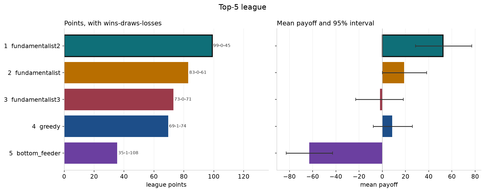

| Rank | Strategy | Points | W–D–L | Mean payoff | Std. error | Win rate | Mean rank |
|---:|---|---:|---|---:|---:|---:|---:|
| 1 | fundamentalist2 | 99.0 | 99–0–45 | +52.3 | 12.5 | 0.58 | 2.13 |
| 2 | fundamentalist | 83.0 | 83–0–61 | +18.9 | 9.8 | 0.52 | 2.35 |
| 3 | fundamentalist3 | 73.0 | 73–0–71 | −2.0 | 10.4 | 0.48 | 2.46 |
| 4 | greedy | 69.5 | 69–1–74 | +8.6 | 8.6 | 0.34 | 2.48 |
| 5 | bottom_feeder | 35.5 | 35–1–108 | −63.0 | 10.2 | 0.26 | 3.00 |

`fundamentalist2` is the champion. The interval on the right of the chart is a 95% bootstrap interval for that strategy's mean league payoff. The champion's interval sits above zero. `bottom_feeder`'s sits below it. `fundamentalist3` and `greedy` both have intervals that cross zero, and they are the pair the two columns disagree about: `greedy` made more chips on average (+8.6 against −2.0), while `fundamentalist3` won more duels (73 against 69.5). Head to head, `fundamentalist3` beat `greedy` by 32 chips and finished ahead in 67% of their games. Points follow the duels. Chips follow the size of the wins. Both columns are in the chart so that difference is visible.

Over every game a strategy played, including the qualifier, the same order holds for the two fundamentalists, with wider intervals because the qualifier blowouts are in the average:

| Strategy | Games | Mean payoff | 95% interval | Win rate | Stage reached |
|---|---:|---:|---|---:|---|
| fundamentalist2 | 99 | +66.8 | 39.2 to 97.0 | 0.60 | league |
| fundamentalist | 99 | +33.7 | 9.9 to 59.7 | 0.54 | league |
| greedy | 99 | +11.7 | −4.1 to 28.8 | 0.33 | league |
| fundamentalist3 | 102 | −2.8 | −22.5 to 16.8 | 0.45 | league |
| bottom_feeder | 99 | −48.8 | −73.5 to −20.9 | 0.28 | league |
| random | 9 | −207.9 | −292.6 to −110.2 | 0.00 | table 3 |
| chartist | 9 | −300.0 | −323.4 to −269.0 | 0.00 | table 3 |

### Head to head

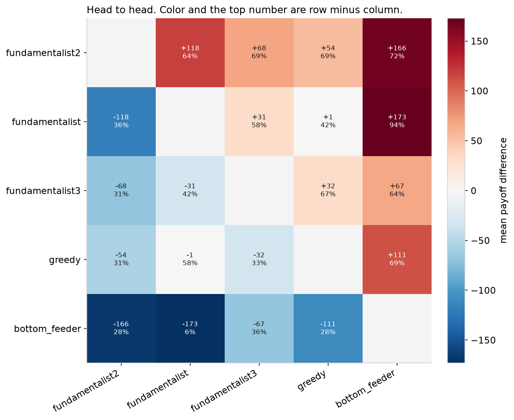

Each cell is `fundamentalist2`'s row minus the column, in the ordering of the league. The top number is the mean payoff difference. The percentage is how often the row finished with the higher payoff. `fundamentalist2` is ahead of all four others: +118 against `fundamentalist` (64%), +68 against `fundamentalist3` (69%), +54 against `greedy` (69%), and +167 against `bottom_feeder` (72%). The one relationship that does not involve the champion and still matters for the table is `fundamentalist` against `bottom_feeder`: +173 chips, and ahead in 94% of games. `bottom_feeder` quoting other players' prices is a losing policy once those prices are set by someone who knows the payout.

### Did the lead hold up across seeds?

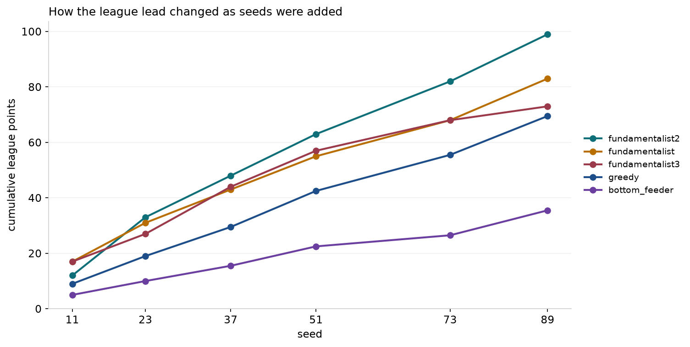

After seed 11, `fundamentalist` and `fundamentalist3` are level with or ahead of `fundamentalist2`. From seed 23 on, `fundamentalist2` is in front, and the gap widens through seed 89. `bottom_feeder` is last at every seed. The race is cumulative duel points, so a strategy that wins its duels by a small margin and a strategy that wins them by 100 chips plot the same. The payoff chart above is what carries the margin.

### How wide is a single game?

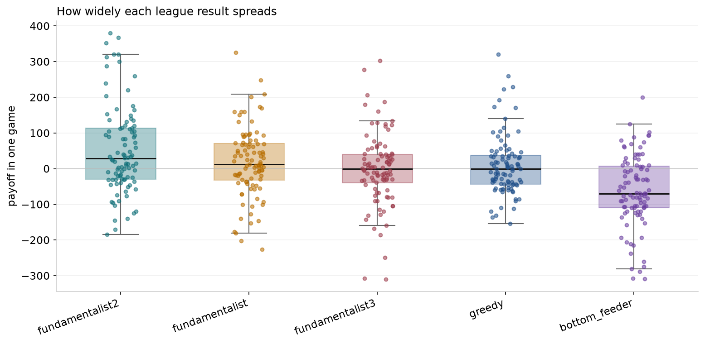

A league game is four rounds of ten seconds, and the deal still dominates a single sitting. `fundamentalist2`'s games cluster higher than the others, and it still has games below zero. The box is the quartiles. The points are the individual games. Reading one match as a ranking would be a mistake. The league's 96 games per strategy are what make the ordering stable.

### Does the edge survive being outnumbered?

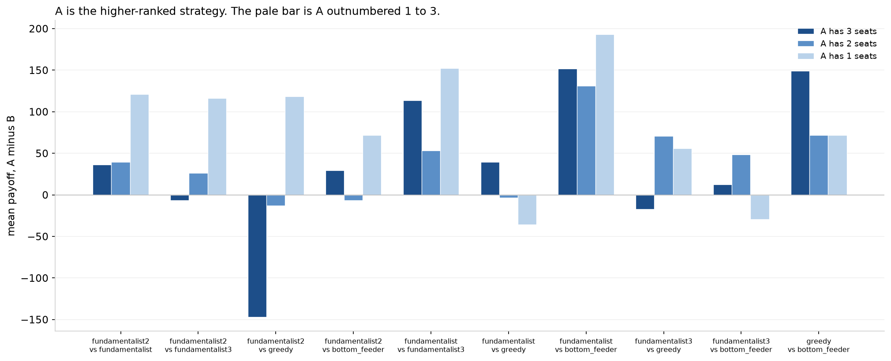

For each pair, A is the strategy with the better league rank. The three bars are A's payoff minus B's when A occupies 3 seats, 2 seats, and 1 seat.

Against the plain fundamentalist, `fundamentalist2`'s lead is positive in all three mixes, and it is largest when `fundamentalist2` is the single seat: +36 with three seats, +40 with two, +121 with one. One copy, taking mispriced quotes from three copies of the random-quoting fundamentalist, is the matchup the greedy rule was built for.

Against `greedy` the shape flips. With one seat, `fundamentalist2` is ahead by +118. With three seats it is behind by −147. Three copies of `fundamentalist2` are competing to take the same greedy quotes, and the average across those copies suffers. The rule still finds the bad prices. It does not get better because you cloned it.

## Reproduce the tournament

From this folder, with the virtualenv above:

```bash
.venv/bin/python tournament.py
```

Qualifier seeds, league seeds, round length, tick, and worker count are flags: `--seeds`, `--top5-seeds`, `--round-time`, `--tick`, `--workers`. `--order` fixes the seven-name entry order. A full run is about ten minutes. It writes `results/<timestamp>/` with `games.csv`, `standings.csv`, `summary.csv`, `head_to_head.csv`, and `league.csv`, plus the six charts in `figures/`.

```bash
.venv/bin/python tournament.py --plot-only results/20261003_205258
```

rebuilds the charts from a finished folder. The charts in this README are copied from that run into `docs/tournament/`. Deals are a function of the seed. Quote timing is concurrent, so a second run with the same seeds repeats the decks and can still move the chip totals.

The numbers in this document are from `results/20261003_205258`.

## Where the code lives

| Path | Role |
|---|---|
| `game_engine.py` | Deal, ante, rounds, settlement |
| `order_book.py` | Quotes, trades, order handles |
| `player.py` | The seven strategies and the 12-deck valuation |
| `card.py` | A card's suit and color |
| `utils.py` | Chip amounts, clocks, tournament seeds |
| `analyse.py`, `figures.py` | Parse a `figgie.log` and draw the greedy-bot charts |
| `analyser.ipynb` | The notebook that walks through those charts |
| `tournament.py` | Qualifiers, league, CSVs |
| `tournament_figures.py` | The six tournament charts |
| [`CONTEXT.md`](../CONTEXT.md) | The names used for the goal suit, quotes, bids, offers, trades, and the pot |
